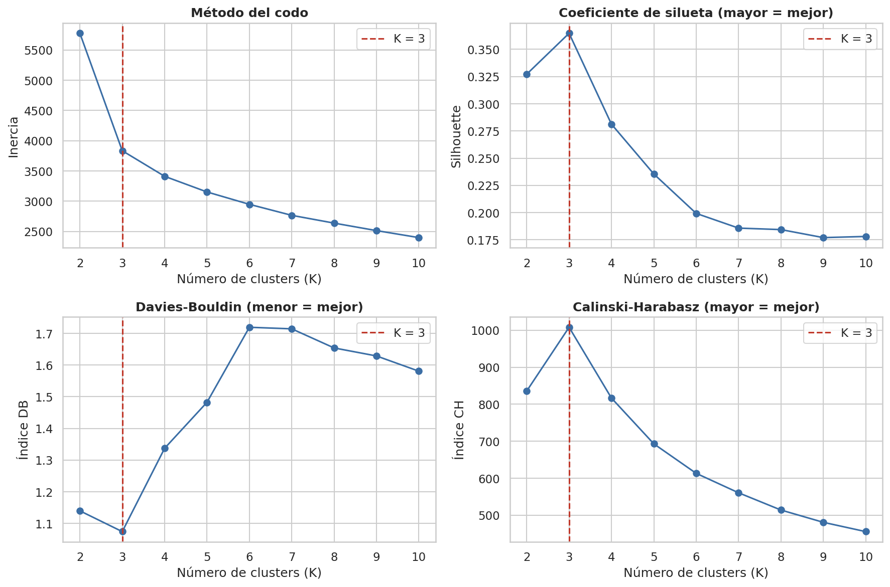
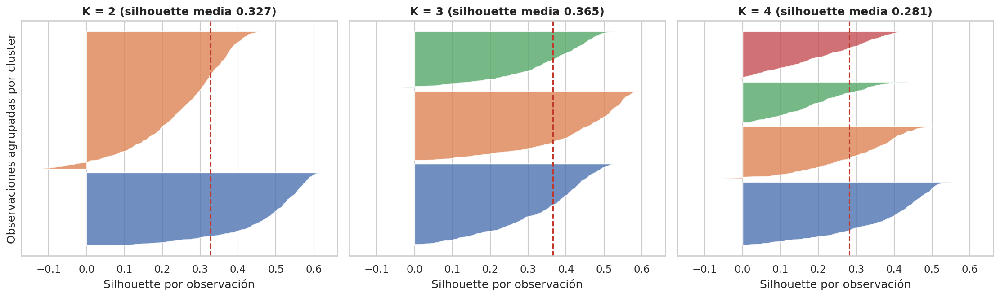
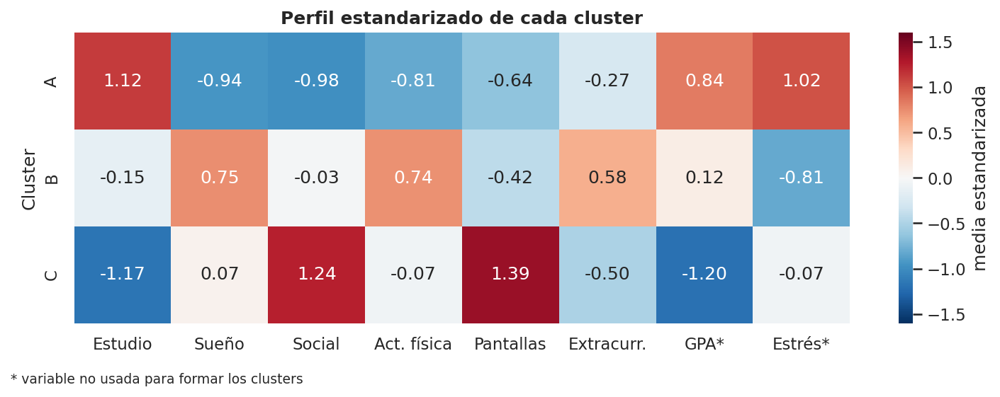
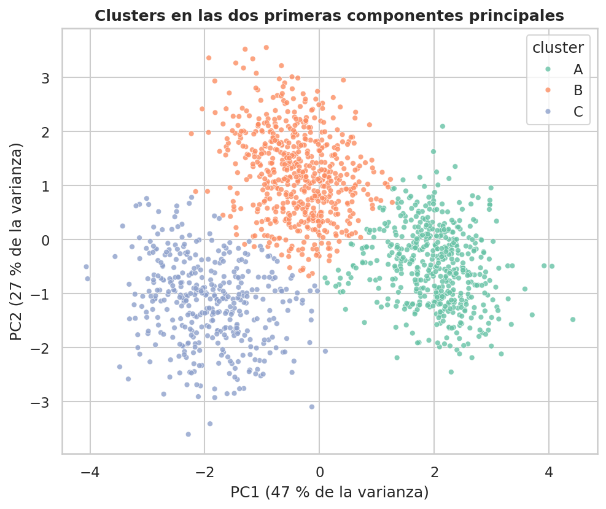

# Segmentación de Estudiantes con K-Means

Agrupo a 1 500 estudiantes según sus hábitos diarios con K-Means y analizo después cómo se comportan el GPA y el estrés en cada grupo. Todo está en `notebooks/student_segmentation_kmeans.ipynb`.

Cada fila es un estudiante:

| Columna | Descripción |
|---|---|
| `student_id` | Identificador |
| `study_hours`, `sleep_hours`, `social_hours` | Horas diarias de estudio, sueño y vida social |
| `physical_activity_hours`, `screen_time_hours`, `extracurricular_hours` | Horas diarias de actividad física, pantallas y extracurriculares |
| `gpa` | Promedio académico (escala 0-4) |
| `stress_score`, `stress_level` | Estrés de 0 a 10 y su nivel (Low, Moderate, High) |
| `age`, `field_of_study` | Edad y área de estudio |

El archivo trae 1 512 filas porque incluye 12 repetidas, y le faltan unos 30 valores de sueño y 30 de pantallas.

Para formar los clusters uso solo las seis variables de horas, estandarizadas. El GPA, el estrés, la edad y el área quedan fuera y los uso después para describir los grupos. Quito los duplicados, relleno los nulos con la mediana y dejo los valores extremos, porque son posibles y quitarlos casi no cambia el resultado. K lo elijo mirando varios criterios a la vez (dos versiones del codo, silhouette, Davies-Bouldin y Calinski-Harabasz) y comparando la silhouette con la de los mismos datos con las columnas mezcladas al azar. K-Means va con 20 inicializaciones y semilla 100, y compruebo la estabilidad con distintas semillas y con remuestreo bootstrap.

Cuatro de los cinco criterios dan K = 3 (silhouette 0,365 frente a 0,135 con datos mezclados) y la partición es estable (ARI de 0,985 por bootstrap). Salen tres perfiles:

| Cluster | Estudiantes | Estudio | Sueño | Social | Act. física | Pantallas | Extracurr. | GPA | Estrés |
|---|---|---|---|---|---|---|---|---|---|
| A, sobrecarga académica | 500 (33,3 %) | 8,39 | 5,60 | 1,07 | 0,51 | 2,61 | 1,00 | 3,45 | 7,58 |
| B, equilibrado | 592 (39,5 %) | 5,39 | 7,55 | 2,56 | 1,57 | 3,04 | 1,58 | 3,13 | 4,03 |
| C, alta distracción digital | 408 (27,2 %) | 2,98 | 6,76 | 4,55 | 1,02 | 6,47 | 0,85 | 2,56 | 5,46 |

Horas por día. El estudio, la vida social y las pantallas son lo que más separa a los grupos, y el GPA y el estrés se mueven con las horas de estudio. Son asociaciones, no causas.

| | |
|---|---|
|  |  |
|  |  |
├── README.md
├── requirements.txt
├── data/
│ ├── raw/student_habits.csv
│ └── processed/cluster_assignments.csv
├── notebooks/student_segmentation_kmeans.ipynb
├── src/ # carga y limpieza, K-Means y métricas, perfilamiento, generador de datos
├── reports/
│ ├── figures/
│ └── results/
└── models/ # preprocesador, modelo y mapeo de etiquetas


Para ejecutarlo (Python 3.11 o superior):

```bash
python -m venv .venv
source .venv/bin/activate
pip install -r requirements.txt
jupyter notebook notebooks/student_segmentation_kmeans.ipynb
```

Los datos ya vienen incluidos; si quieres regenerarlos, python src/generate_data.py. Con datos reales los grupos estarían probablemente menos separados y las métricas serían más bajas.